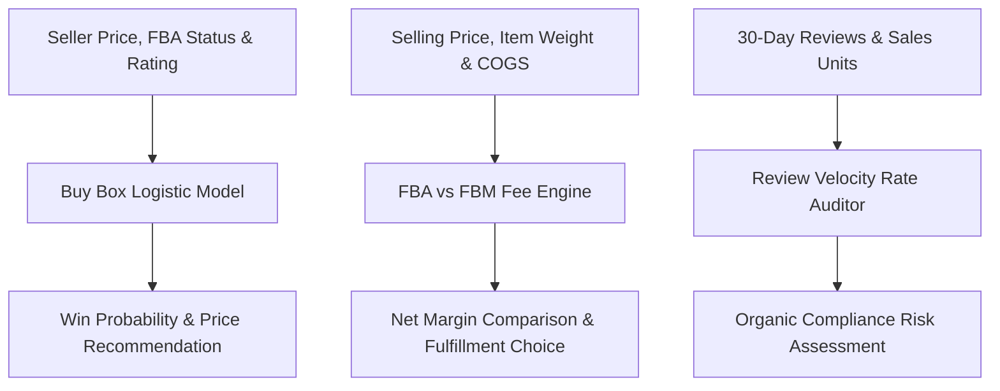

# genpark-amazon-market-analyzer


GenPark Amazon Market Analyzer is a zero-dependency Amazon seller performance and listing optimization engine implementing logistic Buy Box win probability modeling, multi-tier FBA vs FBM unit cost and margin arbitration, and organic review-to-sales velocity anomaly fraud detection.



## Features
- **Buy Box Win Predictor**: Models capture likelihood based on relative price delta, Prime fulfillment, and merchant feedback score.
- **FBA vs FBM Profit Arbitrage**: Evaluates Amazon pick-and-pack fee schedules against merchant shipping costs to maximize unit profit.
- **Review Velocity Fraud Auditor**: Benchmarks review conversion rates against organic e-commerce averages to prevent listing suppression.

## Quickstart

```python
from client import GenParkAmazonMarketAnalyzer

analyzer = GenParkAmazonMarketAnalyzer()
res = analyzer.predict_buy_box_win_probability(29.99, 29.99, is_fba=True)
print("Buy Box Win Probability:", res["buy_box_win_probability_pct"], "%")
```

## License
MIT
